# AASTMT Enterprise Network


A highly available, multi-branch enterprise network for the Arab Academy for Science, Technology and Maritime Transport (AASTMT), connecting the Smart Village, Sheraton and Dokki campuses in a single OSPF domain.

Developed at the Information Technology Institute (ITI), Cloud Architecture 47, as a CCNA capstone project.

## Contents

- [Overview](#overview)
- [Architecture](#architecture)
- [Technologies Implemented](#technologies-implemented)
- [IP Addressing Plan](#ip-addressing-plan)
- [Implementation Details](#implementation-details)
- [Verification](#verification)
- [Repository Structure](#repository-structure)
- [Getting Started](#getting-started)
- [Team](#team)
- [License](#license)

## Overview

AASTMT is expanding across several locations and requires a network that is scalable, resilient and secure. This design connects three branches and applies the same logical structure to each one: five VLANs (Students, Instructors, IT, Management, Servers), consistent addressing, and uniform security controls.

| Branch | Code | Role |
|--------|------|------|
| Smart Village | SV | Main branch: data center, core switching, two WAN edge routers |
| Sheraton | SH | Remote branch: router-on-a-stick, local DHCP |
| Dokki | DK | Remote branch: router-on-a-stick, local DHCP |

## Architecture

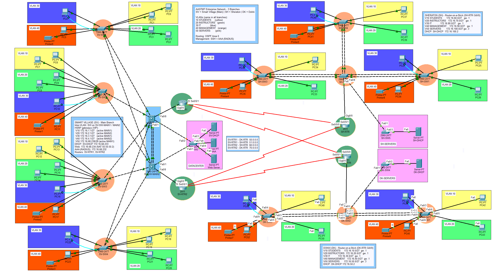

**Smart Village** follows a three-block design. Four access switches serve the user VLANs, two 3560 multilayer switches form the core (inter-VLAN routing and HSRP), and a server block hosts the DHCP, Web and AAA servers. Every access switch has one uplink to each core switch, so no single device or link failure isolates users.

**Sheraton and Dokki** use a collapsed distribution design. A hub switch (SH-SW2 / DK-SW2) connects the access switches over EtherChannel, trunks to the branch router, and trunks to the local DHCP server switch.

**WAN.** Smart Village is dual-homed. SV-RTR1 and SV-RTR2 each have one serial link to Sheraton and one to Dokki. The remote branches are not linked directly, so inter-branch traffic transits Smart Village and survives the loss of either edge router.

| Link | Network |
|------|---------|
| SV-RTR1 to DK-RTR | 50.0.0.0/30 |
| SV-RTR1 to SH-RTR | 51.0.0.0/30 |
| SV-RTR2 to SH-RTR | 60.0.0.0/30 |
| SV-RTR2 to DK-RTR | 70.0.0.0/30 |
| SV-SW-MAIN1 to SV-RTR1 | 10.0.0.0/30 |
| SV-SW-MAIN2 to SV-RTR2 | 10.0.0.4/30 |

**Inventory:** 4 Cisco 2911 routers, 2 Cisco 3560-24PS multilayer switches, 14 Cisco 2960-24TT switches, 5 servers, 44 PCs and 9 printers.

## Technologies Implemented

| Objective | Technology | Scope |
|-----------|-----------|-------|
| Efficient address use | VLSM on 172.16.0.0/16 (/27 users, /28 servers, /30 links) | All branches |
| Traffic segmentation | VLANs 10/20/30/40/50 with 802.1Q trunking | All branches |
| Inter-VLAN routing | SVIs (SV), Router-on-a-Stick (SH, DK) | All branches |
| Link redundancy | EtherChannel using PAgP | All branches |
| Gateway redundancy | HSRP with per-VLAN load balancing | Smart Village |
| Dynamic routing | OSPF process 1, Area 0 | All Layer 3 devices |
| Automated addressing | Local DHCP server per branch with relay | All branches |
| Public web access | Static NAT, 172.16.68.234 to 50.50.50.2 | SV-RTR1, SV-RTR2 |
| Secure management | AAA with RADIUS, local fallback, SSH only | All Layer 3 devices |

## IP Addressing Plan

| VLAN | Name | Smart Village | Sheraton | Dokki |
|------|------|---------------|----------|-------|
| 10 | Students | 172.16.1.0/27 | 172.16.60.0/27 | 172.16.10.0/27 |
| 20 | Instructors | 172.16.2.0/27 | 172.16.70.0/27 | 172.16.20.0/27 |
| 30 | IT | 172.16.3.0/27 | 172.16.80.0/27 | 172.16.30.0/27 |
| 40 | Management | 172.16.4.0/27 | 172.16.90.0/27 | 172.16.40.0/27 |
| 50 | Servers | 172.16.68.224/28 | 172.16.100.0/27 | 172.16.50.0/27 |

Gateways: HSRP virtual IP `.1` per VLAN in Smart Village (`172.16.68.238` for VLAN 50); router sub-interface `.1` in Sheraton and Dokki (`.3` for VLAN 50).

| Server | Address | Function |
|--------|---------|----------|
| SV-DHCP | 172.16.68.233 | DHCP for Smart Village |
| Web Server | 172.16.68.234 | HTTP/HTTPS and DNS, published as 50.50.50.2 |
| AAA | 172.16.68.232 | RADIUS, UDP 1645 |
| SH-DHCP | 172.16.100.2 | DHCP for Sheraton |
| DK-DHCP | 172.16.50.2 | DHCP for Dokki |

## Implementation Details

### Inter-VLAN Routing

Smart Village routes VLANs on the two core switches using SVIs. Sheraton and Dokki use a single trunk to the branch router, split into 802.1Q sub-interfaces:

```
interface GigabitEthernet0/0.10
 encapsulation dot1Q 10
 ip address 172.16.60.1 255.255.255.224
 ip helper-address 172.16.100.2
```

### EtherChannel

All bundles are 802.1Q trunks negotiated with PAgP (`channel-group <n> mode desirable`). The core switches are joined by Port-channel 1 (Fa0/6-7), which also carries HSRP hellos. Sheraton and Dokki hub switches bundle two links to each access switch.

### HSRP

The group number matches the VLAN ID, and preemption is enabled on every SVI. Load is split across the cores: SV-SW-MAIN1 is active for VLANs 10, 30 and 50, and SV-SW-MAIN2 is active for VLANs 20 and 40. The active switch runs priority 110.

### OSPF

| Device | Router ID |
|--------|-----------|
| SH-RTR | 1.1.1.1 |
| SV-RTR1 | 2.2.2.2 |
| DK-RTR | 5.5.5.5 |
| SV-SW-MAIN1 | 8.8.8.8 |
| SV-SW-MAIN2 | 9.9.9.9 |
| SV-RTR2 | 10.10.10.10 |

Core-to-edge uplinks (Fa0/8) are routed ports for stable point-to-point adjacencies. Sheraton to Dokki traffic has two equal-cost paths, so OSPF can load-share and fail over.

### DHCP

Each branch has a local server in VLAN 50, so a WAN outage does not stop address assignment. User-VLAN gateways relay requests with `ip helper-address`. Addresses .1 to .4 of every VLAN are excluded from the pools.

### Static NAT

```
ip nat inside source static 172.16.68.234 50.50.50.2     ! SV-RTR1 and SV-RTR2
ip route 50.50.50.2 255.255.255.255 51.0.0.1             ! SH-RTR
ip route 50.50.50.2 255.255.255.255 50.0.0.1             ! DK-RTR
```

Remote PCs reach `http://50.50.50.2`. SV-RTR1 translates the destination to the internal web server and reverses the translation on the reply.

### AAA and SSH

`aaa new-model` is enabled on all six Layer 3 devices. Console login uses the local database. VTY login uses RADIUS first (172.16.68.232) with local fallback. Telnet is disabled with `transport input ssh`, and passwords are stored encrypted.

## Verification

| Feature | Commands / test | Evidence |
|---------|-----------------|----------|
| VLANs, Smart Village | `show vlan brief`, `show interfaces trunk` | 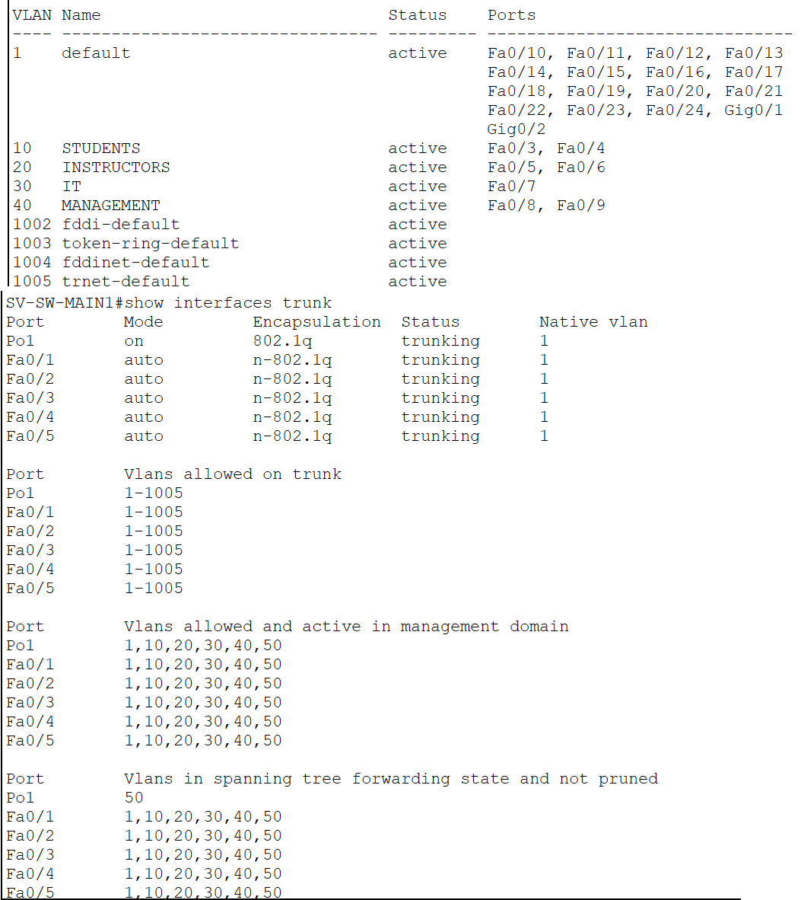 |
| VLANs, Sheraton | `show vlan brief` | 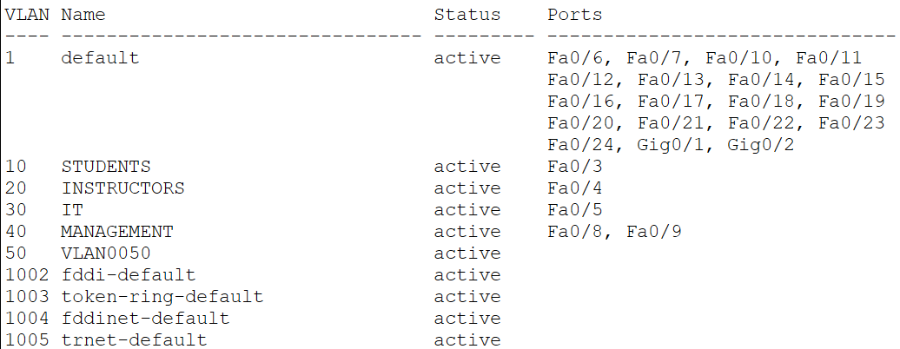 |
| VLANs, Dokki | `show vlan brief` |  |
| SVI routing | `show ip interface brief`, ping PC0 to PC2 | 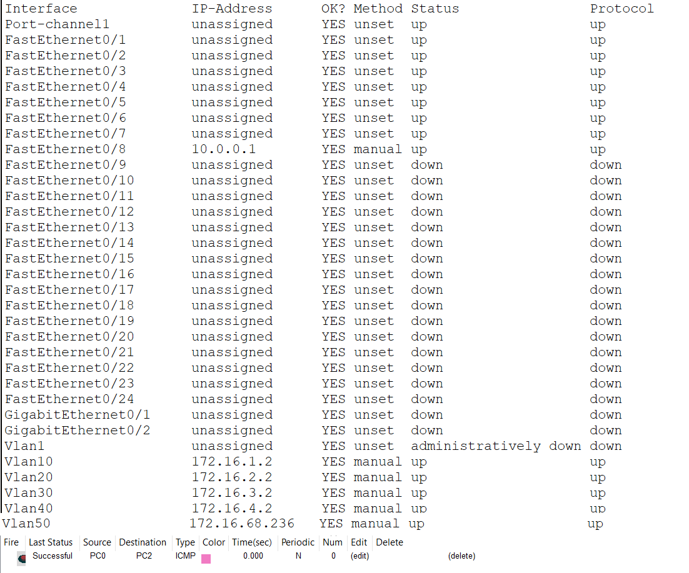 |
| Router-on-a-Stick | `show ip interface brief`, ping PC42 to PC46 | 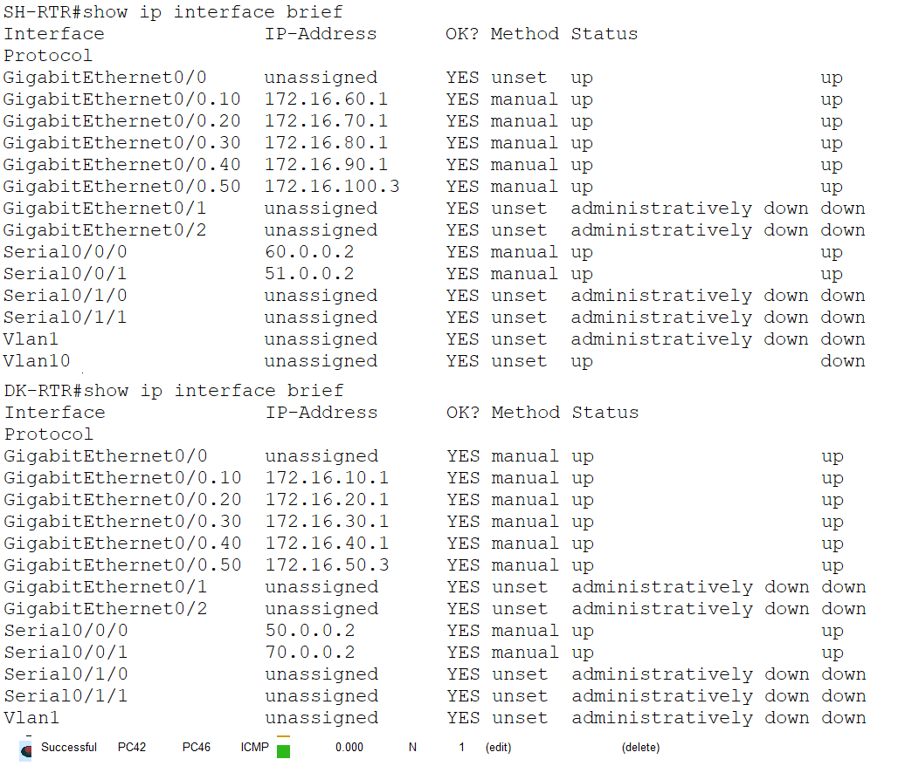 |
| EtherChannel | `show etherchannel summary` | 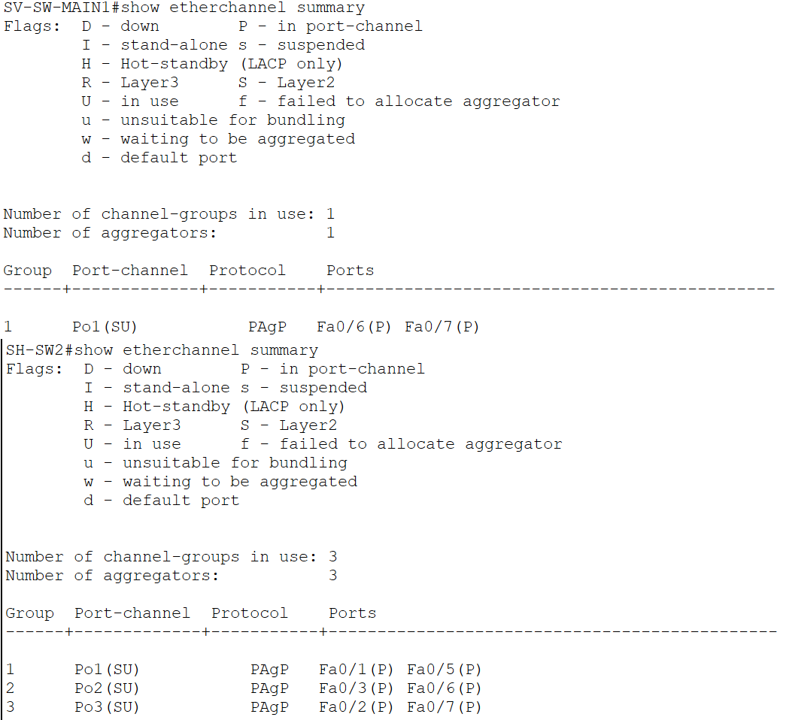 |
| HSRP | `show standby brief` | 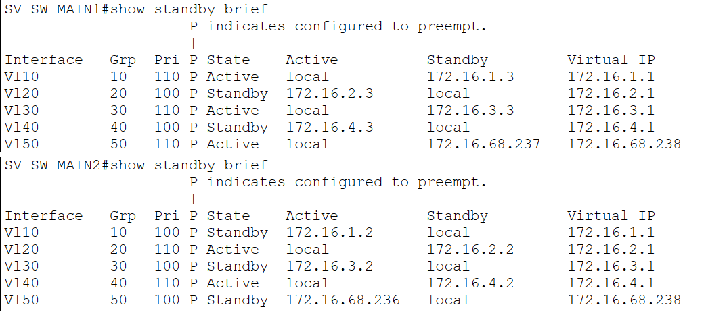 |
| OSPF neighbors and routes | `show ip ospf neighbor`, `show ip route ospf` | 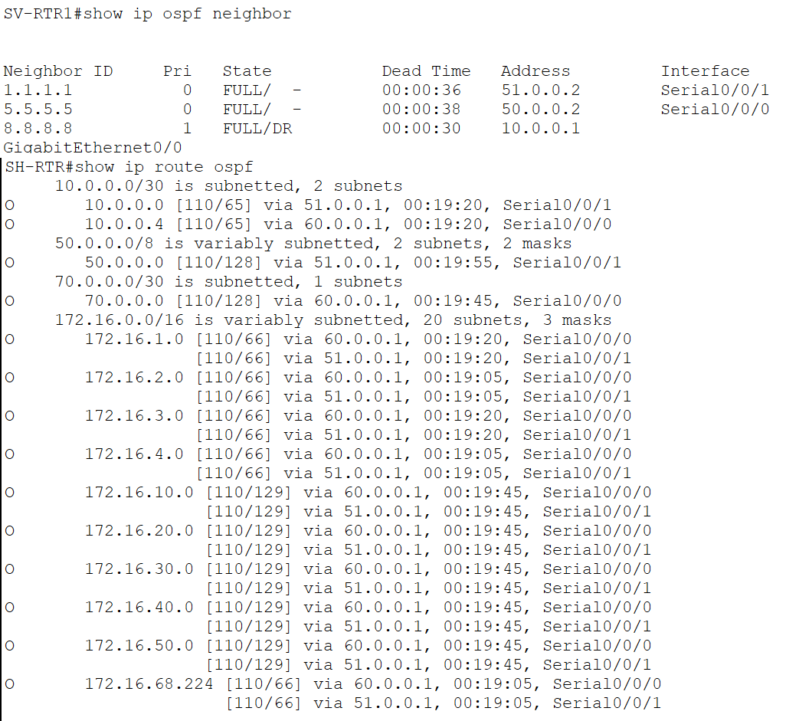 |
| WAN redundancy | ping and tracert, Sheraton to Dokki | 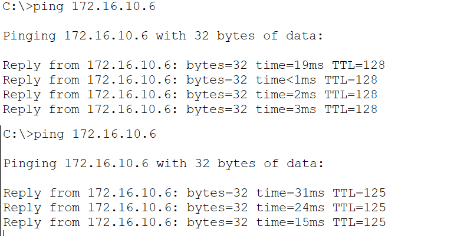 |
| DHCP, Smart Village | IP Configuration on PCs | 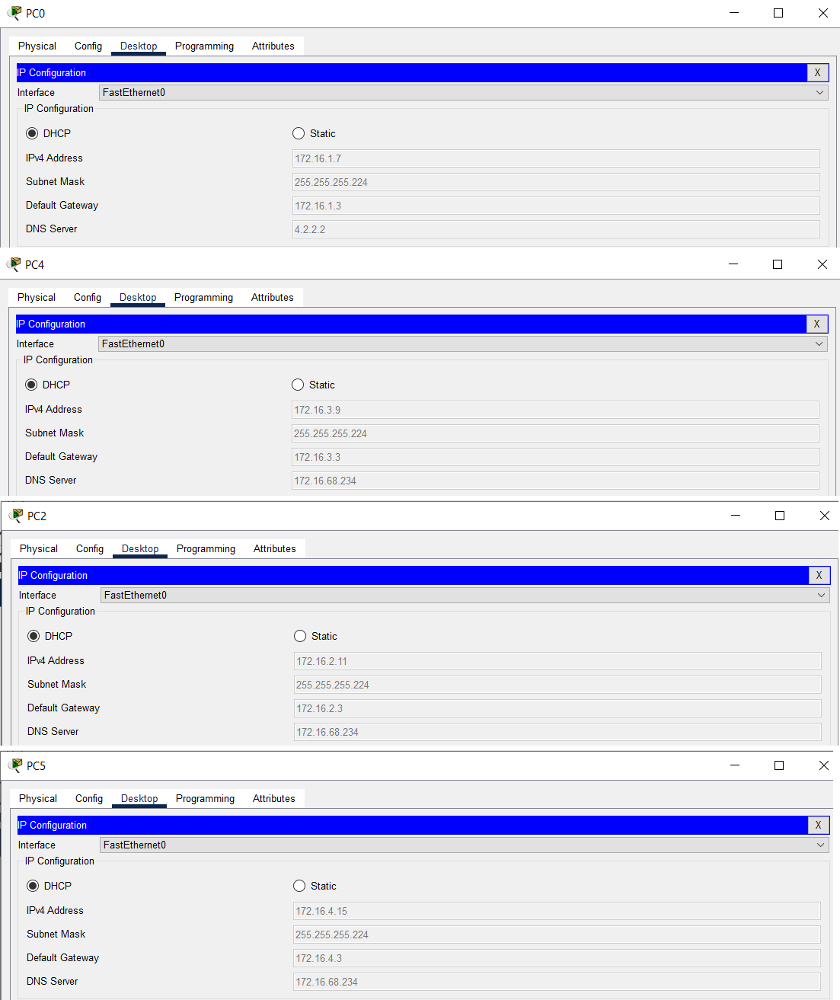 |
| DHCP, Sheraton | IP Configuration on PCs |  |
| DHCP, Dokki | IP Configuration on PCs | 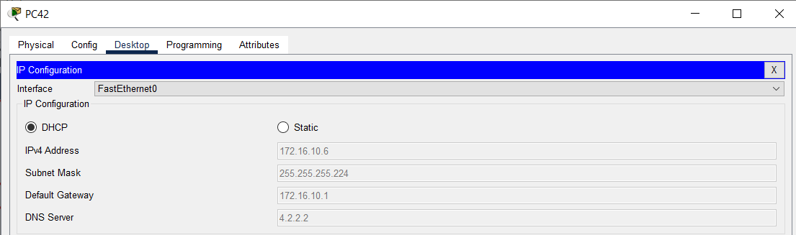 |
| NAT configuration | `show running-config \| include nat` | 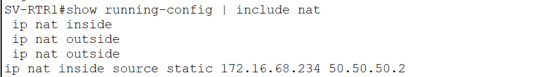 |
| NAT test | Browser to 50.50.50.2, `show ip nat translations` | 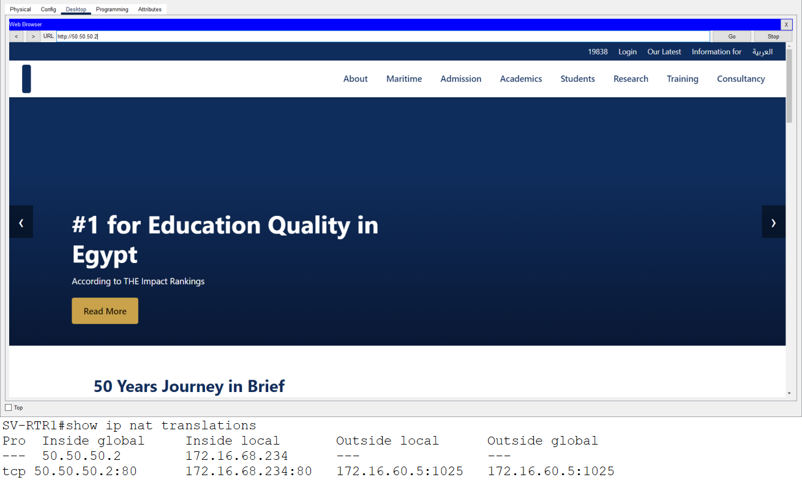 |
| AAA / RADIUS | `show running-config \| section aaa` | 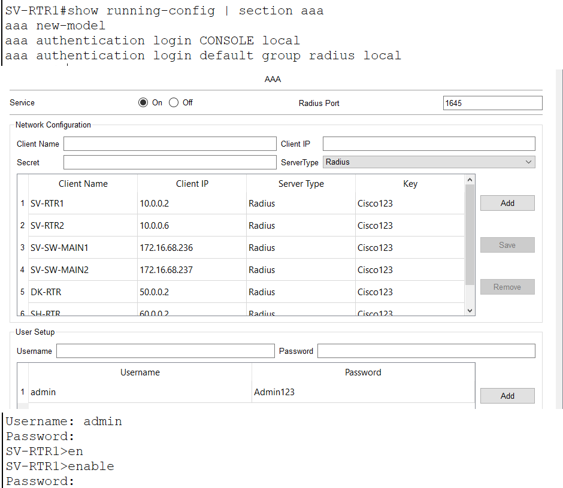 |
| SSH access | `ssh -l admin 10.0.0.2` | 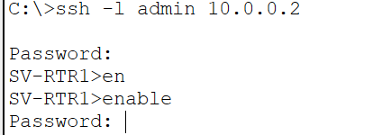 |

## Repository Structure

```
.
├── README.md
├── Network.pkt            Packet Tracer project file
├── docs/
│   └── Documentation.pdf     Full technical documentation (49 pages)
└── images/
    ├── full-topology.png
    └── evidence/             Verification screenshots
```

## Getting Started

1. Install Cisco Packet Tracer.
2. Clone the repository and open `Project_22.pkt`.
3. Allow about a minute for OSPF to converge.
4. Validate the build:
   - Ping between PCs in different VLANs and different branches.
   - Browse to `http://50.50.50.2` from a Sheraton or Dokki PC.
   - Connect with `ssh -l admin 10.0.0.2` from a PC.

The lab credentials are for simulation only and must not be reused in production. Full details are in `docs/Documentation.pdf`.

## Team

- Bola Wagdy Hosny
- Bilal Ali Ibrahem
- Abdulrahman Ayman Mohammed
- Youssef Malak Tawfik

Supervised by Eng. Ekram Abdelwahabnour

## License

This project is licensed under the MIT License — see the [LICENSE](LICENSE) file for details.